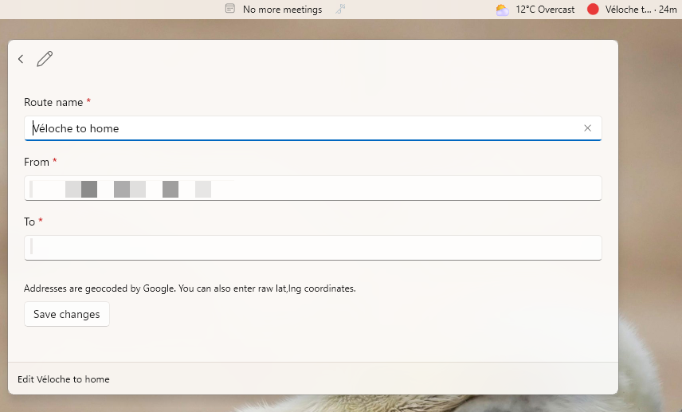

# Google Traffic in your PowerToys Command Palette dock

Live Google Maps traffic for your saved routes, directly in the
[PowerToys Command Palette](https://learn.microsoft.com/en-us/windows/powertoys/command-palette/overview)
and its
[Dock](https://learn.microsoft.com/en-us/windows/powertoys/command-palette/dock).

## Story behind it

I was mad because I left my work to wait 2 hours in my car. I could have worked
extra hours to get paid overtime instead. This small widget allow me now to
check the journey time between two destinations with my car. I just check it
before leaving my work, and if the time is a little bit lower than average, I
leave.

## Features

- **No API key required**
- **Add / edit / delete routes from the palette**
- **Multiple saved routes**, each route gets its own item in the Dock band
- **Live traffic + free-flow durations**
- **Configurable from/to addresses**
- **Configurable refresh rate**, 1 / 5 / 15 / 30 / 60 minutes
- clicking a route opens `google.com/maps/dir/?api=1&...`

## The widget



## Install from the latest release

The MSIX is signed with a self-signed certificate, so Windows must trust the
certificate before the package can install. Run this one-liner in PowerShell: it
downloads the `.cer` file from the release, imports it into
`LocalMachine\TrustedPeople` (accept the UAC prompt, admin is required for that
store), then installs the MSIX:

```powershell
Start-Process powershell -Verb RunAs -ArgumentList '-Command iwr https://github.com/maxerbox/powertoys-dock-google-traffic/releases/latest/download/GoogleTrafficDock.cer -OutFile $env:TEMP\GoogleTrafficDock.cer; Import-Certificate -FilePath $env:TEMP\GoogleTrafficDock.cer -CertStoreLocation Cert:\LocalMachine\TrustedPeople; Add-AppxPackage "https://github.com/maxerbox/powertoys-dock-google-traffic/releases/latest/download/GoogleTrafficDock_1.0.0.0_x64.msix"'
```

If the certificate is already trusted, install directly with:

```powershell
Add-AppxPackage "https://github.com/maxerbox/powertoys-dock-google-traffic/releases/latest/download/GoogleTrafficDock_1.0.0.0_x64.msix"
```

Then open Command Palette, run **Reload**, and pin the traffic page from the
context menu to show it in the dock.

## Build & install (sideload)

Prerequisites: [.NET SDK 10](https://dotnet.microsoft.com/download), Windows
Developer Mode enabled, and the Windows SDK 10.0.26100 installed (from Visual
Studio Installer or the standalone SDK installer):

```powershell
# once: create a self-signed signing cert
$cert = New-SelfSignedCertificate -Subject "CN=GoogleTrafficDock Dev" -Type CodeSigningCert -CertStoreLocation Cert:\CurrentUser\My
$pwd = ConvertTo-SecureString -String "YourPassword" -Force -AsPlainText
Export-PfxCertificate -Cert $cert -FilePath .\GoogleTrafficDock.pfx -Password $pwd
Import-Certificate -FilePath (Export-Certificate -Cert $cert -FilePath .\GoogleTrafficDock.cer) -CertStoreLocation Cert:\CurrentUser\TrustedPeople

# build the MSIX
dotnet publish GoogleTrafficDock\GoogleTrafficDock.csproj -c Release -r win-x64 -p:Platform=x64 `
  -p:GenerateAppxPackageOnBuild=true -p:AppxPackageDir=..\AppxPackages -p:AppxBundle=Never `
  -p:PackageCertificateKeyFile=..\GoogleTrafficDock.pfx -p:PackageCertificatePassword=YourPassword

# install
Add-AppxPackage .\AppxPackages\*\GoogleTrafficDock_*_x64.msix
```

Then open Command Palette → run **Reload** (Reload Command Palette Extension)
and the extension appears.

## License

MIT
